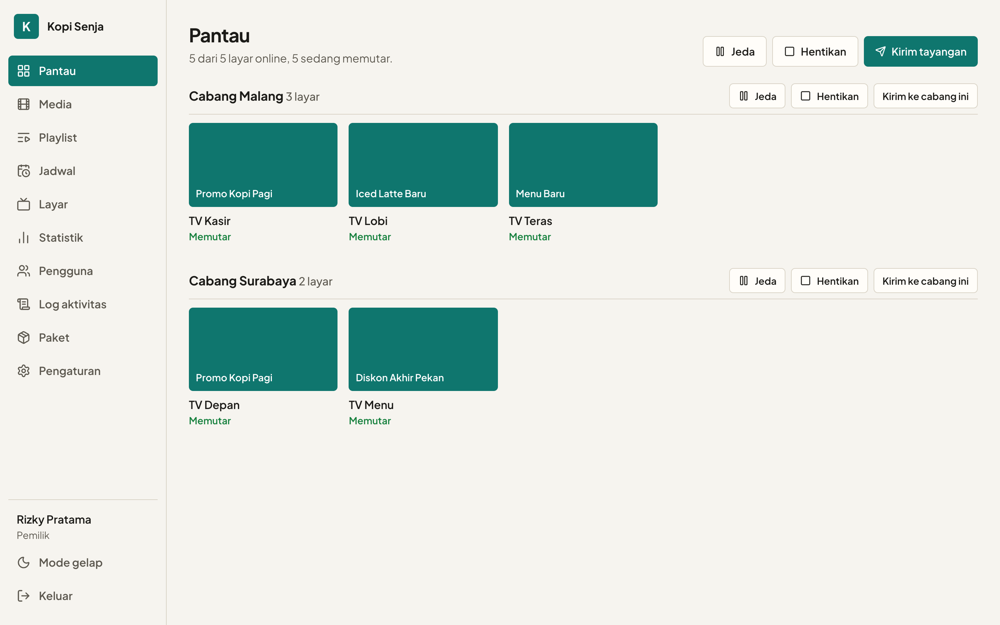
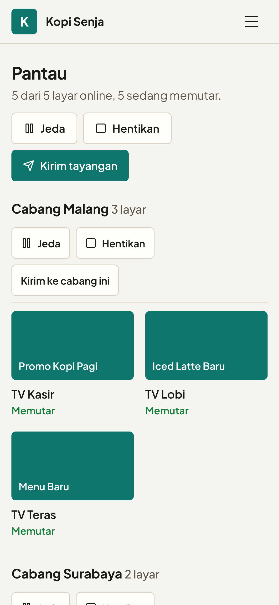

# AdCast

Mengelola tayangan di banyak TV tidak lagi berarti keliling cabang dengan flashdisk. AdCast membuat toko, kantor, klinik, dan usaha multi-cabang bisa mengirim materi promo, mengatur jadwal, dan memantau setiap layar dari satu dashboard.

[](https://react.dev)
[](https://www.typescriptlang.org)
[](https://tailwindcss.com)
[](https://developers.cloudflare.com/workers/)
[](https://hono.dev)
[](./LICENSE)
[](https://adcast.biz.id)



<p align="center">
  
</p>

---

## Fitur Unggulan

### 1. Kirim ke Banyak Layar Sekaligus
- **Satu perintah untuk semua:** kirim video atau playlist ke seluruh TV, per cabang, atau satu layar saja.
- **Mulai bersamaan:** semua layar mulai hampir di detik yang sama, dan TV yang baru dinyalakan tetap ikut di posisi yang tepat.
- **Kontrol langsung:** jeda, lanjutkan, atau hentikan tayangan dari dashboard tanpa menyentuh TV-nya.
- **Jadwal otomatis:** atur jam tayang per cabang, misalnya promo jam makan siang yang jalan sendiri setiap hari.

### 2. Sumber Video yang Luwes
- **Upload dari komputer:** format umum seperti MP4, MOV, MKV, dan AVI.
- **Impor dari cloud:** Google Drive (termasuk satu folder sekaligus), Dropbox, dan OneDrive.
- **YouTube:** cukup tempel tautannya.
- **Diperiksa dan disiapkan otomatis:** file yang tidak bisa diputar TV disesuaikan sendiri, dan file bermasalah tidak pernah sampai ke layar.
- **Foto juga bisa:** untuk menu, daftar harga, atau pengumuman, lengkap dengan durasi tayang sendiri.

### 3. Pantau Kondisi Setiap Layar
- **Status apa adanya:** lihat layar mana yang online, offline, sedang memutar, atau bermasalah, per cabang.
- **Tahu apa yang sedang tayang:** status "sedang memutar" datang dari TV itu sendiri, bukan dari apa yang dikirim dashboard.
- **Tetap jalan saat internet putus:** TV melanjutkan tayangan terakhir yang tersimpan, lalu menyusul sendiri saat jaringan kembali.
- **Notifikasi ke HP:** dapat kabar saat banyak layar mati dalam satu waktu.
- **Waktu lokal otomatis:** jam di dashboard mengikuti WIB, WITA, atau WIT sesuai perangkat yang membuka.

### 4. Statistik, Laporan, dan Jeda Salat
- **Statistik per layar:** waktu online dan durasi tayang tiap materi, lengkap dengan grafik harian dan konten terpopuler.
- **Ekspor CSV:** laporan siap diunduh untuk rapat atau klien.
- **Riwayat sesuai paket:** 7 hari di Gratis, 30 hari di Pro, 90 hari di Bisnis.
- **Jeda salat:** per cabang, mati secara default. Pilih kota atau koordinat, lalu TV menampilkan pemberitahuan salat pada lima waktu dan lanjut sendiri, termasuk jeda Jumat yang lebih panjang.

### 5. Paket, Pembayaran, dan Tampilan Usaha Sendiri
- **Tiga paket** (Gratis, Pro, Bisnis) dengan batas layar, cabang, pengguna, dan materi yang jelas.
- **Uji coba 7 hari** dengan batas Pro, berakhir sendiri tanpa menagih.
- **Bayar dengan QRIS:** total sudah otomatis masuk ke kode QR, tinggal bayar lalu tunggu konfirmasi.
- **Nama, logo, dan warna usaha sendiri** di setiap layar dashboard.
- **Peran dan log aktivitas:** atur siapa boleh mengirim tayangan, siapa hanya memantau, dan verifikasi dua langkah untuk akun penting.

---

## Dokumentasi

| Dokumen | Isi |
|---|---|
| [Panduan Memulai](./docs/getting-started.md) | Menjalankan AdCast di komputer sendiri |
| [Deploy ke Cloudflare](./docs/deployment.md) | Memasang AdCast di domain sendiri |
| [Arsitektur](./docs/architecture.md) | Bagaimana setiap bagian bekerja, dan aturan keamanannya |
| [Saran Fitur](./docs/saran-fitur.md) | Roadmap dan rencana fitur berikutnya |

## Menjalankan di lokal

```sh
pnpm install
cp wrangler.example.jsonc wrangler.jsonc
pnpm db:migrate
pnpm dev
```

Buka `/daftar` untuk membuat usaha pertama, lalu `/player` di tab lain untuk berperan sebagai TV. Detail dan pengaturan opsionalnya ada di [Panduan Memulai](./docs/getting-started.md).

Ingin memasangnya di domain sendiri? Ikuti [Deploy ke Cloudflare](./docs/deployment.md).

---

## Berkontribusi

Pull request dan laporan kendala sangat diterima. Baca [CONTRIBUTING.md](./CONTRIBUTING.md) sebelum mulai. Laporan celah keamanan disampaikan secara privat sesuai [SECURITY.md](./SECURITY.md).

## Lisensi

Dirilis di bawah [Lisensi MIT](./LICENSE).

## Kontak

Dibuat oleh [@rizalahmaddd](https://github.com/rizalahmaddd). Butuh bantuan atau kustomisasi?

- WhatsApp: [+62 857-7777-5477](https://wa.me/6285777775477)
- Website: [solusikoding.com](https://solusikoding.com)
